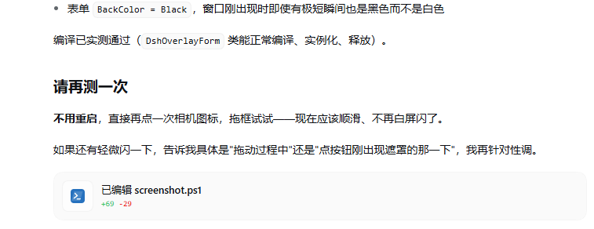

# dsh-screenshot

给 DeepSeek Harness 输入框加一个**豆包式手动截图按钮**：点击相机图标 → 框选屏幕区域 → 截图自动作为图片附件发给模型。**仅支持 Windows**。

A manual screenshot button for the DeepSeek Harness composer: click the camera icon, drag a region, and the capture is sent to the model as an image attachment. **Windows only**.

## 效果 / Demo



## 功能 / Features

- 输入框右侧新增相机按钮（`conversation.input.right` 插槽）。
- 点击后 DeepSeek 窗口**自动最小化**，避免挡住你要截图的区域；框选结束自动恢复。
- 全屏暗色遮罩 + 拖拽框选，选区高亮（双缓冲绘制，拖动不闪白）。
- 松开鼠标即裁剪并作为图片附件发送给模型（无需手动发送）。
- 按 `Esc` 取消。

## 安装 / Install

发布到 [awesome-dsh-plugin](https://github.com/awesome-dsh-plugin/awesome-dsh-plugin) 市场后，可在 DSH 的「插件市场」里搜索 `dsh-screenshot` 一键安装；也可以直接本地安装：

```bash
dsh plugin --profile web add github:luffy2507/dsh-screenshot
```

## 使用 / Usage

1. 打开任意会话。
2. 点击输入框右侧的相机按钮。
3. 在屏幕上拖动框选要截图的区域。
4. 松开鼠标：截图自动作为图片发送给模型。
5. 按 `Esc` 取消。

## 系统要求 / Requirements

- **Windows**（依赖 PowerShell 5.1+ 内置的 `System.Windows.Forms` / `System.Drawing`）。
- DeepSeek Harness `>=0.2.2-rc.1`。

## 工作原理 / How it works

- 客户端（`client.js`）在输入框注入相机按钮，点击后同源 `POST /screenshot/api/capture`。
- 主机端（`index.js`）启动 PowerShell 脚本（`screenshot.ps1`）：
  1. 最小化 DeepSeek 窗口；
  2. `CopyFromScreen` 抓取虚拟屏幕全图；
  3. 显示无边框全屏遮罩，用户拖拽框选；
  4. 裁剪选区保存为 PNG；
  5. 恢复 DeepSeek 窗口。
- 主机端把 PNG 通过 `fileUploads.uploadStream` 上传，再经 `sessionController.prompt` 以 `{ type: "file", receiptId }` 作为图片用户消息投递给模型。

## 限制 / Limitations

- 仅 Windows；Linux/macOS 无法使用（脚本依赖 WinForms）。
- 模型能否「看到」截图取决于所选模型是否支持视觉输入。

## 开发 / Development

```bash
# 本地安装（file: 协议）
dsh plugin --profile web add file:///E:/DeepSeek/_scratch/dsh-screenshot
```

`index.js` 与 `client.js` 改动后需重启 DSH 生效；`screenshot.ps1` 每次截图时被主机端现读，改它无需重启。

## License

[MIT](LICENSE)
